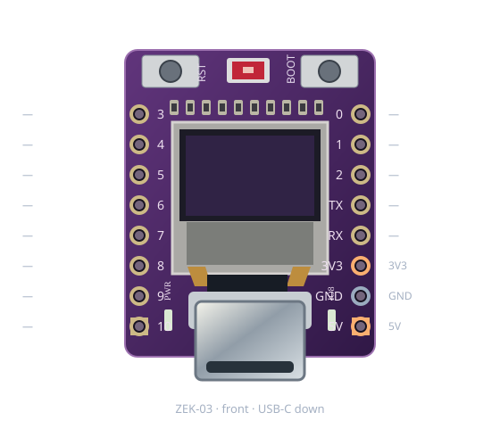

# GPIO Viewer for Mzansi Connect

A local, read-only GPIO viewer for the **Zepkvor ZEK-03 ESP32-C3 OLED board**. It adds a separate menu option to Mzansi Connect and preserves the original GPIO Viewer for comparison.



## What is included

- An original purple-board SVG traced from the supplied product photo: 16 header holes, photographed pin order, OLED, top RST/BOOT buttons and bottom USB-C.
- Live digital, PWM and ADC display using the existing **GPIOViewer 1.7.1** event protocol; no second firmware sampler.
- Pin selection, capability notes, declared modes, sampled activity history, generic list, pause/resume, reconnect and stale-data indicators.
- A self-contained compressed page served by Mzansi on `/gpio-mzansi`. No CDN, external font, image host or cloud account is needed for the device page.
- A new Android menu entry, while retaining Mzansi Dashboard and original GPIO Viewer.
- Non-blocking GPIO8 network LED patterns: two short flashes for home Wi-Fi; long pulses for recovery hotspot mode. LED active-low polarity is an explicit revision assumption pending visual confirmation.
- Hardware evidence, installation, architecture, development and troubleshooting guides, plus a printable PDF.

## Quick start

1. Use the corresponding Mzansi firmware integration (2.2.6) and Android app 1.3.0.
2. Wait **two minutes after flashing or restarting**. Keep the phone and ESP32 on the same reachable Wi-Fi.
3. In Mzansi Dashboard, open **GPIO Live**, enable the viewer and save/restart. Wait two minutes again.
4. Enter the device IP in the Android app, choose **GPIO Viewer for Mzansi Connect**, then enter the device API key.
5. In a browser, open `http://DEVICE_IP/gpio-mzansi`. The original remains at `http://DEVICE_IP:8080/`.

The API key gates the main dashboard check. **The existing port 8080 telemetry service is unauthenticated.** This is a trusted-LAN diagnostic tool, not a secure Internet-facing service.

## Hardware evidence boundary

The photo confirms the external physical labels and order. TX=GPIO21 / RX=GPIO20 is supported by the project's UART wiring/NMEA test and the Espressif C3 variant definition, but no Zepkvor manufacturer schematic was located. OLED controller, resolution, SDA, SCL, address and shared-header wiring remain **unverified for this specific ZEK-03**. The viewer does not initialize the OLED or claim those specifications.

The SVG is a visual reference, **not a dimensioned manufacturing drawing**. Similar-looking SuperMini or ABrobot boards are not substituted for board-specific electrical evidence.

## Documentation

- [Project website and guide](https://SkylineITCloud.github.io/gpio-viewer-mzansi-connect/)
- [Setup](docs/setup.html)
- [Hardware evidence](docs/hardware.html)
- [Architecture and protocol](docs/architecture.html)
- [Troubleshooting](docs/troubleshooting.html)
- [Development](docs/development.html)
- [Verification](docs/verification.html)
- [Release history](CHANGELOG.md)

The hosted demonstration contains simulated values and does not connect to your device. Use the ESP32-served HTTP page for real monitoring; an HTTPS GitHub Pages site cannot be assumed to access private HTTP hardware.

## Build and check

```powershell
python tools/build_assets.py
node tests/telemetry.test.js
npm install
npm run test:browser
```

The builder generates `web/index.html`, `web/zek-03.svg`, `web/board.json`, the upstream-compatible registration and pin indicator JSON, and the firmware gzip header. In this standalone repository the generated header is written to `integration/mzansi_gpio_html.h`; inside the Mzansi workspace it updates the main sketch header.

See the integration guide before changing firmware. This repository does not publish household Wi-Fi credentials, a device API key, Android signing keys, or a preconfigured household firmware image.

## Credits and license

GPIOViewer library and its web protocol are by [thelastoutpostworkshop](https://github.com/thelastoutpostworkshop/gpio_viewer), MIT licensed. The existing upstream application continues to run independently. Original Mzansi viewer code and the new SVG are MIT licensed; see [LICENSE](LICENSE) and [THIRD_PARTY_NOTICES.md](THIRD_PARTY_NOTICES.md).
